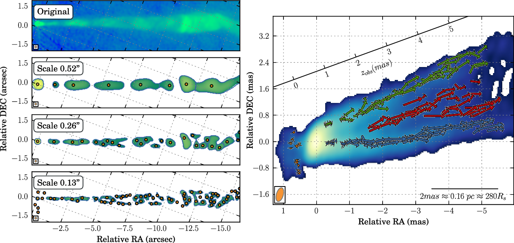

.. note::
   Original walkthrough by Florent Mertens, mirrored from
   https://flomertens.github.io/wise/ under GPL-2.0. See
   `ATTRIBUTION.md <../ATTRIBUTION.md>`_ for full attribution.

WISE: Wavelet Image Segmentation and Evaluation
===============================================

The WISE package has been developed to address the issue of detecting
significant features in radio interferometric images and obtaining reliable
velocity field from cross-correlation of these regions in multi-epoch
observations.

It comprises three main constituents:

- Detection of structural information is performed using the segmented wavelet
  decomposition (SWD) method. The SWD algorithm provides a structural
  representation of astronomical images with exceptional sensitivity for
  identifying compact and marginally resolved features as well as large scale
  structural patterns. It delivers a set of two-dimensional significant structural
  patterns (SSP), which are identified at each scale of the wavelet decomposition.

- Tracking of these SSP detected in multiple-epoch images is performed with a
  multiscale cross-correlation (MCC) algorithm. It combines structural information
  on different scales of the wavelet decomposition and provides a robust and
  reliable cross-identification of related SSP.

- A stacked cross correlation (SCC) is introduced to recover multiple velocity
  components from partially overlapping emitting regions.

This software is based on a method introduced and described in:

| *"Wavelet-based decomposition and analysis of structural patterns in astronomical image"*
| Mertens, F., Lobanov, A.P. 2015, Astronomy & Astrophysics, 574, 67 `ADS <http://adsabs.harvard.edu/abs/2015A%26A...574A..67M>`_

| *"Detection of multiple velocity components in partially overlapping emitting regions"*
| Mertens, F., Lobanov, A.P. 2016, Astronomy & Astrophysics, 587, 52 `ADS <http://adsabs.harvard.edu/abs/2016A%26A...587A..52M>`_

Installation
------------

These instructions install wise-wavelets, the maintained Python 3 port of
WISE, from https://github.com/etmeyer/wise-wavelets. The ``wisetool`` package
on PyPI and the ``flomertens`` conda channel still hold the original Python 2
release (0.4.7).

Conda is the recommended route, since several of the dependencies install more
reliably from conda-forge than from PyPI. The environment installs both
packages (``libwise`` and ``wise``) in editable mode, with all their
dependencies:

::

    git clone https://github.com/etmeyer/wise-wavelets
    cd wise-wavelets
    conda env create -f environment.yml
    conda activate wise-wavelets

A pure-pip install also works, with Python 3.11 or newer:

::

    git clone https://github.com/etmeyer/wise-wavelets
    cd wise-wavelets
    python -m venv .venv && source .venv/bin/activate
    pip install -e packages/libwise
    pip install -e packages/wise
    pip install PyQt5   # needed for the GUI viewers

``wise --version`` prints the installed versions of both packages. The
dependencies and their minimum versions are listed in ``environment.yml`` and
in each package's ``pyproject.toml``.

Using WISE
----------

WISE can be used either from the command line or from an ipython notebook. Check
the tutorials below to see how to use it.

Tutorials
----------

.. toctree::
   :maxdepth: 2

   tutorials_cmd/index
   tutorials_notebook/index

Data file formats:
------------------

.. toctree::
   :maxdepth: 2

   data_formats

Full API documentation:
-----------------------

.. toctree::
   :maxdepth: 2

   docs/index

Indices and tables
==================

* :ref:`genindex`
* :ref:`modindex`
* :ref:`search`

